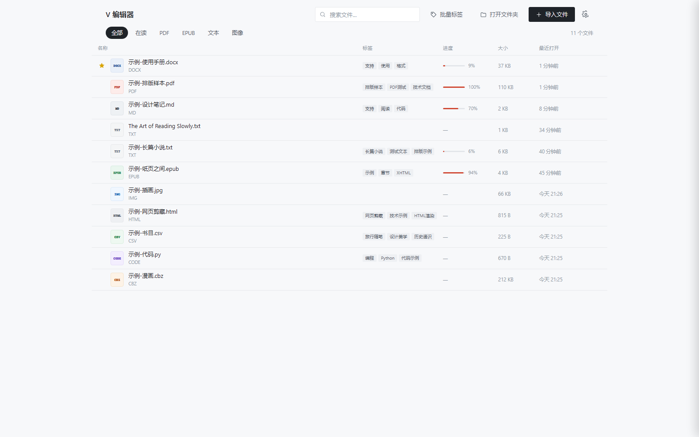

# V 编辑器

**一个本地优先的多格式文档阅读器 —— 读得舒服，记得下来，不上传任何东西。**

Windows 桌面应用（Electron）。PDF、EPUB、Word、Markdown、TXT、HTML、代码、CSV、漫画、图片都能读；划词就能写笔记，笔记卡片贴在原文旁边、连线可以随手捏；同一个窗口能左右分屏对照；AI 是可选插件式的增强，不填 Key 也完全可用。

不用注册、不用登录、没有遥测、没有推荐流。你的书、笔记、进度、设置全都留在这台电脑里。



> 当前版本 **1.1.0** ｜ Windows 10 / 11 x64 ｜ 安装包约 80 MB

---

## 目录

- [为什么做这个](#为什么做这个)
- [下载与安装](#下载与安装)
- [五分钟上手](#五分钟上手)
- [使用手册](#使用手册)
  - [1. 导入与管理文件](#1-导入与管理文件)
  - [2. 阅读](#2-阅读)
  - [3. 笔记](#3-笔记)
  - [4. 分屏双开与标签栏](#4-分屏双开与标签栏)
  - [5. 自动滚动](#5-自动滚动)
  - [6. AI 辅助（可选）](#6-ai-辅助可选)
  - [7. 快捷键](#7-快捷键)
- [支持的格式](#支持的格式)
- [数据、备份与隐私](#数据备份与隐私)
- [常见问题](#常见问题)
- [从源码构建](#从源码构建)
- [项目结构](#项目结构)
- [License](#license)

---

## 为什么做这个

系统自带的阅读器只认一两种格式：PDF 阅读器打不开 EPUB，电子书软件处理不好 Word，代码和 Markdown 只能丢进编辑器；而大多数在线工具都要先上传文件。

于是做了这个：**把日常会读的东西收进同一个界面，全部在本机解析**。文件不出电脑，笔记跟着原文走，读到哪儿下次接着读。

设计上刻意做了减法：白底为主、工具栏默认隐形、笔记卡片在放不下的时候宁可不显示也不压字。

---

## 下载与安装

1. 到 [Releases](https://github.com/vv29614/v-editor/releases) 下载 `VEditor-Setup-1.1.0.exe`
2. 双击安装（可以选择安装位置，默认装到 `D:\VEditor`）
3. 装完桌面会出现「V 编辑器」快捷方式

不需要 Node.js，不需要联网，不需要注册。

**系统要求**：Windows 10 及以上（x64）。安装约 200 MB，安装包 80 MB。

> 首次打开会自动弹出 24 页图文引导，讲一遍所有功能。关掉之后想再看：**设置 → 帮助 → 用法说明**，或首页右上角「使用指南」。

---

## 五分钟上手

1. **拖一个文件进窗口**（或点「导入文件」）——它会出现在首页并自动打开
2. 右上角齿轮调字号、行距、主题，改完立刻生效
3. **选中一段文字**，浮出的小工具条上点「高亮」或「笔记」
4. 笔记会变成一张卡片贴在正文两侧，拖着卡片能换位置，拖右下角小三角能改大小
5. 拖标签栏里的标签往上 → 右边分出一栏，同一本书两处对照
6. 想边看边做别的：点顶栏播放图标，文字会自己往下滚，按 `-` / `=` 调速

---

## 使用手册

### 1. 导入与管理文件

**三种导入方式**

| 方式 | 操作 |
| --- | --- |
| 选文件 | 首页右上角「导入文件」，可多选 |
| 拖拽 | 把文件拖进窗口任意位置，松手即导入 |
| 整个文件夹 | 点「打开文件夹」逐层浏览并导入 |

导入只登记文件路径，**不复制文件本体**——所以原文件被移动或删除后，这里就打不开了（会提示找不到）。

**首页（书架）**

- 顶部筛选：全部 / 在读 / PDF / EPUB / 文本 / 图像
- 搜索框：按文件名和标签搜
- 每行显示：名称、标签、阅读进度、大小、最近打开时间
- 星标：点行首的星，收藏的书排在列表最前面
- 右键一本书：打开、生成标签（本地）、AI 生成标签、在资源管理器中显示、移出书架
- 「移出书架」只是从列表拿掉，**不会删除你的文件**

**批量处理（1.1.0 新增）**

- 每行最左边有复选框，勾上后顶部出现批量操作条
- 一次可做：生成标签、AI 标签、加星标、取消星标、标为在读、移出书架
- 勾选一个后，直接点其他行是继续勾选（不会误开书）；按住 `Shift` 点某行可选中两者之间全部

### 2. 阅读

**顶栏从左到右**

| 按钮 | 作用 | 快捷键 |
| --- | --- | --- |
| ← | 返回书架 | `Esc` |
| ← / → | 回到上一个 / 下一个位置 | `Alt + ←/→` |
| 两栏图标 | 分屏双开 | — |
| 列表图标 | 目录 | `Tab` |
| 放大镜 | 全文搜索 | `/` |
| 准星 | 跳转定位（页码 / 百分比） | `Ctrl + G` |
| 书签图标 | 书签与笔记侧栏 | `B` |
| 翻译 | 划词/整段翻译 | `Ctrl + Shift + T` |
| AI | 问这篇文档 | — |
| 播放 | 自动滚动 | `Ctrl + Shift + O` |
| 图钉 | 窗口置顶 | — |
| 喇叭 | 朗读 | `R` |
| 月牙 | 切换主题（白天/夜间/护眼） | `T` |
| 齿轮 | 阅读设置 | `S` |
| 四角 | 全屏 | `F` |

**排版调节**（设置 → 排版）

字号、行距、段间距、版心宽度、字体、选中高亮色，都能单独调。改完立刻生效，下次打开保持。

版心宽度决定每行多长——太长容易串行，一般 640～760 比较舒服。

**不同格式的差异**

- **PDF**：文本层可选可搜，支持大纲目录、双页、缩放、夜间模式
- **EPUB**：解析 OPF，章节与目录，内嵌图片自适应
- **Word（DOCX）**：标题、列表、表格、内嵌图片
- **Markdown / TXT / HTML / RTF**：统一排版；TXT 自动识别 GBK 与「第 X 章」分章
- **代码**：语法高亮 + 行号；**CSV**：渲染成表格；**图片**：缩放旋转；**CBZ/ZIP**：按文件名排序，可双页读

**位置与书签**

- 关掉书、关掉程序，下次会回到上次读到的位置
- `Ctrl + D` 加书签；侧栏（`B`）里点书签或笔记直接跳回原文并闪一下
- `Alt + ←/→` 在「跳过的位置」之间来回，像浏览器一样

### 3. 笔记

**划词工具条**

选中正文文字后浮出，从左到右：

1. 四个颜色点（黄 / 红 / 绿 / 蓝）——高亮颜色
2. **高亮**：给选中的字加底色
3. **笔记**：打开写笔记的窗口（上半是摘录，下半写你的想法）
4. **翻译**：弹出译文（配了 AI 走 AI，没配走免费通道）
5. **AI**：解释 / 概括 / 改写 / 术语表 / 就这段提问
6. **导图**：把这段内容画成思维导图，显示在右侧
7. **编辑**：进入整篇编辑模式（`Ctrl + E`）
8. **朗读**：念选中这段
9. **复制**

**笔记卡片**

- 卡片贴在正文左右两侧，跟着文字一起滚动
- **拖卡片**空白处 → 换位置，松手出现 **✓ / ✕**：✓ 记住新位置，✕ 回到原位置
- **拖右下角斜纹小三角** → 同时改宽和高
- 卡片上的五个按钮：`✎` 编辑、`⌁` 单独调这条连线、`AI` 用 AI 处理这条笔记、`◈` 画成导图、`×` 删除
- 窗口太窄、或正文放大到没有空位时，卡片会先收起来不挡字，侧栏「笔记」里仍然都在

**连线**

每张卡片都有一条虚线指向原文，这条线是软的：

- **点一下线**，线上的小圆点冒出来，每个都能拖
- 两端的点分别控制「从卡片哪里出来」和「指到哪个字」，拖它们等于改长度和落点
- **双击线**在点击处插入新节点；**双击中间的点**删掉它
- 卡片上的 `⌁` 单独改这条线的样式：弯曲线 / 直线 / 折线 / 不画线
- 设置 →「笔记连线」统一改所有线的样式、颜色、粗细，以及卡片离正文的距离

**侧栏与导出**

顶栏书签图标（`B`）打开侧栏：上半是书签，下半是这本书的全部笔记。点条目跳原文。「导出笔记」把笔记导成 Markdown。

### 4. 分屏双开与标签栏

**分屏**

- 把标签**往上拖出标签栏** → 右边立刻分出一栏，显示这本书
- 或者点顶栏「两栏」图标，对当前这本书分屏；再点一次收起
- 两栏各滚各的，中间的分隔线可以左右拖调宽度
- 分屏那一栏是干净模式：只有正文，不带工具栏和侧栏
- 两栏共用同一份数据，笔记和进度是通的

**标签栏**

- 第一个标签固定是「首页」，点它随时回书架；在书架里点书标签也能直接进书
- 标签可以左右拖动排序，`×` 关掉；关掉当前标签会自动切到旁边那本
- 同一个文件可以开多个标签，各自记住阅读位置

### 5. 自动滚动

- 点顶栏播放图标（`Ctrl + Shift + O`）开始，再点一次停
- 运行中按 `-` 减速、按 `=` 加速，屏幕会提示当前速度
- 设置 →「自动滚动速度」细调，范围 5～300 像素每秒
- 滚到底会自动停；已经在底部时点按钮会从头开始
- PDF 里也能用（自动找真正能滚的那一层）

### 6. AI 辅助（可选）

**AI 不是必须的**：不填也能读书、记笔记、做标签，只是没有 AI 那几样。

**怎么接上**

设置 →「AI 服务（可选）」，填三样：

| 字段 | 例子 |
| --- | --- |
| 接口地址 | `https://api.deepseek.com` |
| 模型名 | `deepseek-chat` |
| API Key | `sk-...` |

接口需要是 OpenAI 兼容格式（`/chat/completions`）。Key 只存在本机数据目录。

**四种用法**

1. **划词就问**：解释 / 概括 / 改写 / 术语表 / 就这段提问——每次只问选中的一段，比整篇丢给 AI 准
2. **整本书问答**：顶栏 AI 面板知道你正在读哪本书、哪一章，可以连着追问三四轮
3. **笔记 AI**：展开成一段、润色这条笔记、浓缩成一句、结合正文再想、基于这条提问
4. **正文与其他**：编辑模式里对段落「润色 / 精简 / 扩写 / 改正式 / 校对 / 续写」；首页「批量标签」让 AI 给文件自动打标签；划词「导图」生成思维导图

所有 AI 结果都建议当草稿看，落笔前自己过一遍。

### 7. 快捷键

| 操作 | 默认键 |
| --- | --- |
| 目录 | `Tab` |
| 全文搜索 | `/` |
| 书签与笔记侧栏 | `B` |
| 朗读 | `R` |
| 切换主题 | `T` |
| 阅读设置 | `S` |
| 全屏 | `F` |
| 位置前进 / 后退 | `Alt + →` / `Alt + ←` |
| 跳转定位 | `Ctrl + G` |
| 编辑文档 | `Ctrl + E` |
| 翻译 | `Ctrl + Shift + T` |
| 自动滚动开/关 | `Ctrl + Shift + O` |
| 自动滚动调速 | `-` / `=` |
| 添加书签 | `Ctrl + D` |
| 返回书架 | `Esc` |

**全部可改**：设置 →「快捷键」，点某一项按新的组合即可，有冲突会提示。

---

## 支持的格式

| 类别 | 扩展名 | 说明 |
| --- | --- | --- |
| 电子书 | `.pdf` `.epub` | 文本层选择、目录大纲、双页、缩放 |
| 办公文档 | `.docx` | 标题、列表、表格、内嵌图片 |
| 纯文本 | `.md` `.markdown` `.txt` `.html` `.htm` `.rtf` | 自动识别 GBK 与分章 |
| 漫画 | `.cbz` `.zip` | 按文件名排序，双页阅读 |
| 数据 | `.csv` | 渲染成表格 |
| 代码 | `.js` `.ts` `.py` `.c` `.cpp` `.h` `.java` `.go` `.rs` `.json` `.xml` `.yml` … | 语法高亮 + 行号 |
| 图片 | `.jpg` `.png` `.webp` `.gif` `.bmp` | 缩放、旋转 |

---

## 数据、备份与隐私

**全部数据都在一个文件夹里：**

```
%APPDATA%\V编辑器\data\
├─ shelf.json          # 书库清单（路径、标签、进度、星标）
├─ books/              # 每本书的笔记与书签
├─ settings.json       # 阅读设置、快捷键、AI 配置
└─ covers/             # 封面缓存
```

- **便携模式**：在程序目录放一个 `portable.txt`，数据就改到程序旁边的 `data/`
- **备份**：把整个 `data` 文件夹拷走即可；换电脑拷回去，重新导入书（路径变了要重新指向）
- **覆盖安装升级不会清空**这个目录；卸载默认也保留（方便重装后接着用）
- **不存在也不会上传**：没有账号、没有云同步、没有遥测、没有第三方统计；只有你自己配的 AI 接口会在你主动提问时收到你发送的内容

---

## 常见问题

**Q：拖进来的文件过几天打不开了？**
A：导入只记路径不复制文件。原文件被移动/删除/改名就会失效，重新导入新的路径即可（笔记仍在，绑定的是书 ID）。

**Q：TXT 打开是乱码？**
A：会自动识别 UTF-8 与 GBK；少数「GB18030 老文件」可能识别失败，用记事本另存为 UTF-8 再导入最稳。

**Q：PDF 放大到很大有点糊？**
A：PDF 是矢量渲染，缩放按倍率重绘；超过 200% 后受页面尺寸限制会略软。建议配合「版心宽度」和窗口大小调整，而不是一直放大。

**Q：点了 AI 没反应？**
A：会提示「先在设置里填 AI 接口」并自动打开设置。检查接口地址、模型名、Key 三项；也确认网络能访问该接口。

**Q：卸载后重装，书和笔记还在吗？**
A：在。数据在 `%APPDATA%\V编辑器\data`，卸载不清空；但如果手动删了这个目录就没了，重要笔记建议定期拷一份。

**Q：能在 Mac 或 Linux 上用吗？**
A：目前只提供 Windows 包。源码是 Electron + 原生 JS，理论可以自己打包其他平台，但没做适配与测试。

---

## 从源码构建

**依赖**：Windows、Node.js ≥ 18（本机用 24）、npm

```bash
git clone https://github.com/vv29614/v-editor.git
cd v-editor
npm install
```

**开发（浏览器调试）**

```bash
npm start
# 打开 http://127.0.0.1:7788
```

后端是 `server.js`（Node http 服务，负责文件读取、笔记存储、AI 代理），前端在 `public/`，改完刷新即可。

**Electron 开发模式**

```bash
npm run electron
```

**打包 Windows 安装包**

```bash
npm run dist
# 产物：release/VEditor-Setup-<version>.exe
```

`electron-builder` 配置在 `package.json` 的 `build` 字段里；图标处理在 `scripts/afterPack.js`。

---

## 项目结构

```
├─ main.js               Electron 主进程（窗口、数据目录、IPC）
├─ preload.js            安全桥：暴露有限的原生能力给前端
├─ server.js             本地 http 服务：静态资源、文件读取、笔记存储、AI 代理
├─ public/
│  ├─ index.html         单页界面
│  ├─ css/app.css        样式（白底为主，变量驱动主题）
│  ├─ js/
│  │  ├─ app.js          主逻辑（书架、阅读、笔记、连线、分屏、引导…）
│  │  ├─ store.js        本地数据模型与持久化
│  │  ├─ util.js         小工具
│  │  └─ viewers/        各格式渲染器：pdf / epub / flow / code / media
│  └─ vendor/            本地化的第三方库（pdf.js、mammoth、marked、jszip…）
├─ welcome/              首次运行放入的书架示例文件
└─ scripts/              构建辅助脚本
```

**技术栈**：Electron 33、原生 JS（无框架、无构建步骤）、Node `http`、pdf.js、mammoth、marked、jszip、highlight.js、DOMPurify。

**一些实现上的选择**

- 前端不引入框架，直接操作 DOM——启动快、包体小、行为可预测
- 所有第三方库都本地化到 `public/vendor`，离线可用
- 笔记层内容锚定在正文容器内（不是固定定位），所以滚动时笔记天然跟随原文
- 卡片位置、大小、连线形状都存「相对锚点的偏移」，换字号/窗口大小后仍然贴在原文附近
- 长文档分批渲染（每批 60 行），几万行的 TXT 也不卡首屏

---

## 贡献

Issue 和 PR 都欢迎。提 bug 时请附上：

- Windows 版本、V 编辑器版本
- 文件格式与大致大小（**不要上传有版权的书**，说明格式即可）
- 复现步骤与截图

代码风格：跟前现有文件保持一致即可——原生 JS、无框架、注释写「为什么」而不是「做什么」。

---

## License

[MIT](LICENSE) © 2026 V Editor Contributors

第三方库的许可证见 `public/vendor/` 下各自的 LICENSE 文件。
